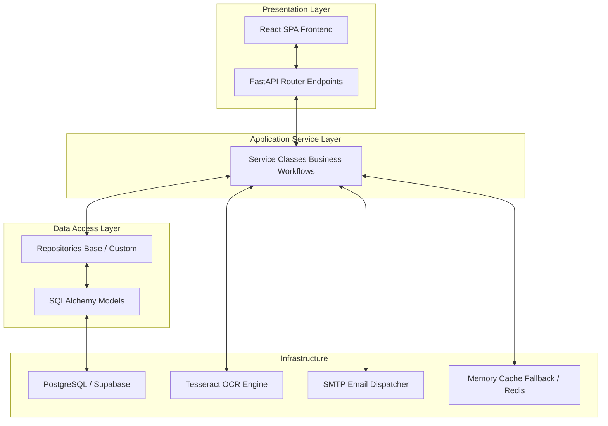

# Enterprise Expense & Procurement Workflow Platform
## Application Architecture

This document describes the high-level system architecture, design patterns, and layer structure implemented in the application codebase.

---

## **Architectural Style: Clean Architecture & DDD**

The application is structured based on Clean Architecture and Domain-Driven Design (DDD) principles. Dependency rules flow inwards: the core domain and business logic are completely decoupled from external frameworks, APIs, databases, or third-party client integrations.

---

## **Layered Directory Structure**

### **1. Presentation & Routing Layer (`src/api/`)**
*   **Purpose**: Manages HTTP request reception, routing, CORS controls, and response formulation.
*   **Key Details**:
    *   Utilizes **FastAPI APIRouter** files organized by entity (e.g., `purchase_requisitions.py`, `vendors.py`, `auth.py`).
    *   Leverages Pydantic models (`src/schemas/`) for rigid payload parsing and field-level validation.
    *   Utilizes Depends injection (e.g., `get_current_active_user`) to guarantee authentication constraints are verified before endpoint body execution.

### **2. Core Configuration & Middleware Layer (`src/core/`, `src/middleware/`)**
*   **Purpose**: Bootstrapping, logging configurations, global exception traps, and request tracing.
*   **Key Details**:
    *   `src/core/config.py`: Loads and parses environment values using Pydantic `BaseSettings`.
    *   `src/middleware/exceptions.py`: Standardizes error mapping. Intercepts exceptions to log them with the unique request identifier before responding with a generic `500 Internal Server Error`.
    *   `src/middleware/request_id.py`: Injects a unique `X-Request-ID` header into every request context to allow tracing database updates back to specific API requests.

### **3. Application Services Layer (`src/services/`)**
*   **Purpose**: Orchestrates business logic, transaction scopes, and system rules.
*   **Key Details**:
    *   All transactional logic (e.g., budget encumbrance checks in PR creation, three-way matching comparison, blacklist checks) is isolated in Service classes (e.g., `PRService`, `ApprovalService`, `POService`).
    *   Services retrieve data via Repositories and commit database transactions.

### **4. Data Access Layer (`src/repositories/`, `src/database/`)**
*   **Purpose**: Database connections, connection pooling, and raw CRUD queries.
*   **Key Details**:
    *   `src/database/database.py`: Establishes the SQLAlchemy 2.0 AsyncEngine targeting Supabase with connection pooling limits.
    *   `src/repositories/base.py`: The `BaseRepository` provides generic asynchronous CRUD queries (e.g., `get`, `create`, `update`, `delete`, `list`) to abstract SQLAlchemy query construction away from the application services.

### **5. Domain / Model Layer (`src/models/`)**
*   **Purpose**: Declares declarative database schemas, relationships, and property configurations.
*   **Key Details**:
    *   Defines tables using SQLAlchemy's Declarative Base class `Base`.
    *   Implements relationships, foreign keys, and indexes (e.g., `users.py`, `purchase_requisition.py`, `vendors.py`).

---

## **Design Patterns & Coding Standards**

*   **Repository Pattern**: Isolates data persistence details from business layers.
*   **Dependency Injection**: Dependencies (like database sessions, current user, service instances) are injected dynamically at runtime by FastAPI.
*   **Asynchronous I/O**: The entire backend relies on `async` / `await` syntax to leverage concurrency and maximize connection pooling throughput.
