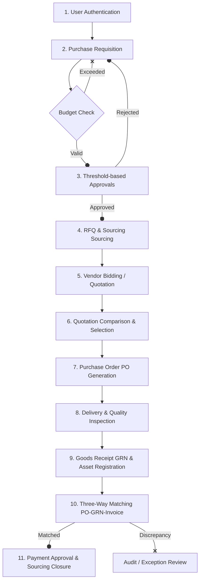

# Enterprise Expense & Procurement Workflow Platform
## Business & Application Workflow

This document illustrates the end-to-end operational lifecycle of the procurement system, detailing how requests progress from an initial requisition to final vendor payment and asset tracking.

---

## **Workflow Overview**

---

## **Detailed Stage-by-Stage Workflow**

### **Stage 1: Identity & Authentication**
*   **Internal Personnel** (Employees, Managers, Admins) log in securely using corporate Google OAuth 2.0.
*   **External Vendors** log in securely using passwordless email OTP (One-Time Passcode) verification.
*   **Role-Based Access Control (RBAC)** assigns permissions corresponding to functional duties (e.g., *Requester*, *Approver*, *Sourcing Officer*, *Warehouse Staff*, *Accounts Payable*).

---

### **Stage 2: Purchase Requisition (PR) Creation & Budget Check**
1.  An employee (*Requester*) creates a **Purchase Requisition** listing required goods/services.
2.  Each line item must target a designated **Cost Center** and **Budget Code**.
3.  **Encumbrance Verification**: The system verifies that the required total does not exceed the remaining balance in the cost center's budget allocation. 
4.  If valid, the system creates a **Budget Reservation** (holding the funds to prevent double-spending) and submits the PR to the approval pipeline.

---

### **Stage 3: Approval Routing Engine**
1.  The PR is evaluated against the **Approval Matrix**.
2.  The routing engine sequentially assigns approval tasks to department heads and executives based on defined financial thresholds.
3.  **Actions**:
    *   **Approve**: The PR moves to the next step. If it reaches the end of the sequence, it transitions to the *Sourcing* phase.
    *   **Reject**: The budget reservation is immediately released, and the PR is returned to the requester.
    *   **Comment / Request Information**: Collaborative notes can be appended directly to the PR history.

---

### **Stage 4: Sourcing (RFQ) Sourcing**
1.  Once the PR is approved, the *Sourcing Officer* creates a **Request for Quotation (RFQ)**.
2.  The Sourcing Officer selects a group of pre-qualified **Vendors** to invite. (Any blacklisted vendors are automatically filtered out).
3.  Invited vendors are notified via email to submit their bids.

---

### **Stage 5: Vendor Quotation Bidding**
1.  The invited vendor logs in using an OTP verification code.
2.  The vendor reviews the requested line items and submits unit pricing, tax values, and delivery terms in a **Vendor Quotation**.
3.  Compliance documents or catalog sheets can be attached.

---

### **Stage 6: Sourcing Evaluation & Purchase Order (PO) Creation**
1.  After the bidding deadline passes, the Sourcing Officer generates a **Quotation Comparison Matrix**.
2.  The system evaluates bids based on pricing and vendor rating scores.
3.  The Sourcing Officer selects the winning quotation and provides a written justification.
4.  The system converts the selected quotation into a formal **Purchase Order (PO)**.
5.  If the PO exceeds the officer's authorization limit, it is routed for final executive approval.

---

### **Stage 7: Delivery & Goods Receipt (GRN)**
1.  The vendor ships the items and provides carrier details.
2.  On arrival, *Warehouse Staff* create a **Delivery** record and perform a quality check (**Inspection Report**), documenting accepted vs. rejected/damaged quantities.
3.  A **Goods Receipt Note (GRN)** is generated for accepted items.
4.  **Asset Management Trigger**: If any items belong to an depreciable asset category (e.g., IT hardware), they are automatically logged in the **Assets Registry** with unique asset tags.

---

### **Stage 8: Three-Way Matching & Invoice Verification**
1.  The vendor submits an **Invoice** to Accounts Payable.
2.  The system executes a **Three-Way Match** checking:
    *   **Purchase Order** (What was ordered and at what price?)
    *   **Goods Receipt** (What was actually received?)
    *   **Vendor Invoice** (What is the vendor billing?)
3.  If the values align within defined tolerances, the invoice is marked *Matched* and approved for payment.
4.  If a discrepancy is identified (e.g., quantity or unit price mismatch), the invoice is blocked and routed to the audit exception queue.

---

### **Stage 9: Payment & Sourcing Closure**
1.  Approved payments are queued and processed.
2.  The reserved budget is converted from *Reserved* to *Spent*.
3.  A **Procurement Closure** record is generated, releasing any residual funds and closing the requisition loop.
